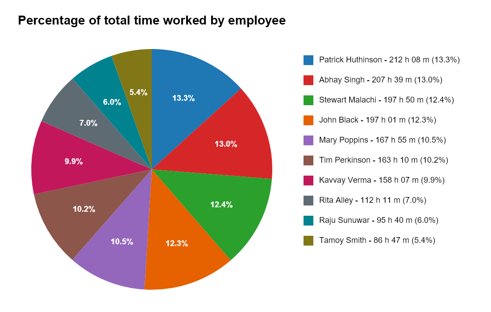

# C# Assignment - Employee time report

C# console app that gets the employee time entries from the API and creates:

- `output/EmployeeTimeReport.html` - table of employees (Name, Total time worked) ordered by total time worked. Rows with less than 100 hours are highlighted.
- `output/EmployeeTimePieChart.png` - pie chart with each employee's percentage of the total time worked.



## How to run

Run `Debangshu Das_C# Assignment.exe` (Windows 64-bit, nothing to install). It creates the `output` folder next to it.

## Notes

Entries are not counted when:
- `DeletedOn` is set
- `EmployeeName` is empty
- the end time is before the start time

## Build

Needs .NET 10 SDK. The chart is drawn with SkiaSharp.

```
dotnet publish TimeEntriesReport -c Release -o publish
```
